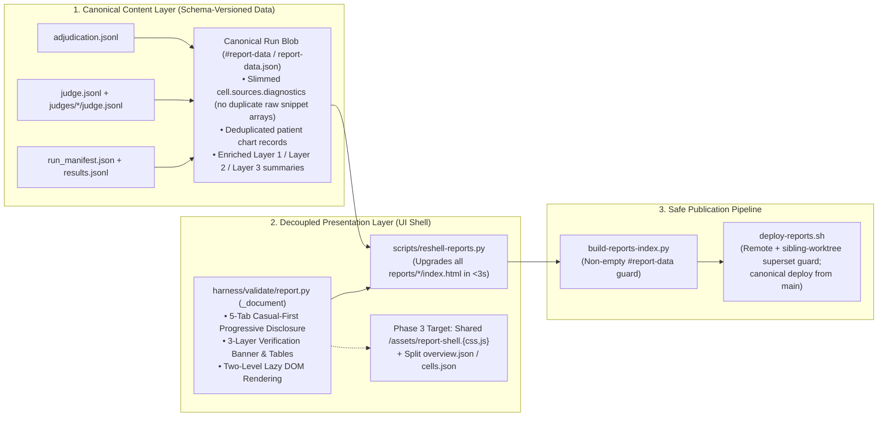

# Report Display vs. Content Separation, Payload Bloat, and Publication Architecture Remediation

**Date:** 2026-11-09  
**Scope:** `clinical-ai-validation-harness` (`harness/validate/report.py`) · `openclinai.org` (`reports/`, `scripts/reshell-reports.py`, `scripts/build-reports-index.py`, `scripts/deploy-reports.sh`)

---

## 1. Executive Summary & Root-Cause Audit

On 9 November 2026, an end-to-end audit of `https://reports.openclinai.org/` and all 33 staged report directories under `reports/` identified four structural failure modes caused by tightly coupling **report presentation (`_STYLE` + `_SCRIPT` + HTML shell)** to **report content (`#report-data` JSON)** inside monolithic static `reports/<slug>/index.html` files and deploying them from parallel git worktrees:

| Failure Mode | Observed Symptom on `reports.openclinai.org` | Root Cause |
| :--- | :--- | :--- |
| **F1. Frozen Legacy UI on Published Reports** | 31 of 32 published reports (including all WAHS and MacBook runs) rendered without the 5-Tab Casual-First UI or 3-Layer Verification Banner (`5-tab=False`, `vtiers=False`). | `build_report()` bakes `_STYLE` (CSS) and `_SCRIPT` (JS) directly into each `reports/<slug>/index.html` at creation time. Subsequent upgrades to `harness/validate/report.py` never propagate to already-published reports unless they are re-shelled. |
| **F2. 18.5 MB Payload Bloat on Multi-Arm WAHS Reports** | `2026-11-05-wahs-multi-family-3-pathway-eval/index.html` (`27 setups × 36 turns = 972 cells`) was **18,537.7 KB (18.5 MB)**; `2026-11-03` was **4.45 MB**; `2026-11-02` was **3.24 MB**. | Inside `run.scenarios` (**15.1 MB**), every cell stored **both** `cell.sources` (**6.5 MB** of raw structured JSON repeating full patient chart snippets across all 27 setups) **and** `cell.sources_html` (**6.0 MB** of pre-rendered HTML cards for the exact same citations), even though the client JS only reads `cell.sources.diagnostics` (3 integer ref counts) and `cell.sources_html`. |
| **F3. Multi-Second Main-Thread Freeze on Boot** | Opening `2026-11-05-wahs-multi-family-3-pathway-eval` blocked the browser main thread while constructing **50,000+ DOM nodes** before first paint. | `renderRun()` synchronously iterated over all 972 cells and injected 6.0 MB of `cell.sources_html` + `cell.refs_html` into live DOM nodes on page load—even when the user starts on **Tab 1 (`Overview`)** (`#sec-answers` hidden) and `.compact-tiles` hides `.sources` (`display: none`). |
| **F4. Parallel Worktree `rsync --delete` Collisions** | Running `scripts/deploy-reports.sh` from a feature worktree lacking sibling branches' `reports/<slug>/` directories wiped WAHS reports from `reports.openclinai.org`. | Multiple active git worktrees had direct SSH access to run `rsync -az --delete` against `34.59.0.158:openclinai.org/artifacts/reports/` without checking remote or sibling-worktree report manifests. |

---

## 2. Guiding Principles & Target Architecture

### Principle 1 — Strict Separation of Content (`#report-data` / `report-data.json`) from Presentation (`report.py` Shell)
- Evaluation runs persist canonical, schema-versioned **content** (`meta`, `summary`, `scenarios`, `judge`, `judge_rows`, `adjudication_rows`, `calibrated`, `arm_cards`).
- The **presentation shell** (`_STYLE` + `_SCRIPT` + HTML skeleton) is a stateless view over that data island. Any UI improvement in `harness/validate/report.py` must be propagatable across the entire historical archive in one deterministic pass (`scripts/reshell-reports.py`), and in Phase 3 via externalized versioned assets (`/assets/report-shell.v2.js`, `/assets/report-shell.v2.css`).

### Principle 2 — Store Facts Once, Render on Demand (Zero Payload Duplication)
- Never embed both multi-megabyte raw citation arrays (`cell.sources.sources`) and pre-rendered HTML (`cell.sources_html`) in the same published artifact.
- Deduplicate patient chart records at the run/patient level (`run.patient_records[patient_uuid]`) rather than repeating identical chart snippets across $M \text{ setups} \times K \text{ turns}$.

### Principle 3 — Sub-200ms First Paint via Progressive / Lazy DOM Construction
- Initial page boot in `Overview (At a Glance)` must only construct DOM nodes for visible overview/summary elements (~2,000–5,500 nodes).
- Scenario answer bands (`#sec-answers`) are constructed lazily when switching to `Browse All Questions` or `All Sections` (for runs with $>20$ cells).
- Per-tile evidence cards (`cell.sources_html` + `cell.refs_html`) are parsed into DOM nodes lazily only when a user clicks `expand`, `⛶` (fullscreen), or `Show evidence & audit tables` (for runs with $>60$ cells).

### Principle 4 — Single Canonical Publication Baseline (`main`) + Mechanical Superset Guards
- Feature branches and worktrees merge to `main` rather than diverging indefinitely.
- `scripts/build-reports-index.py` rejects any staged report whose `<script id="report-data">` has `0` scenarios or `0` backends.
- `scripts/deploy-reports.sh` verifies that local `reports/reports-index.json` is a strict superset of **both** the live remote host manifest over SSH **and** all local sibling git worktrees before `rsync` runs.

---

## 3. Phased Remediation Plan & Execution Status

### Phase 1 — Immediate Unification, Re-Shelling, Payload Slimming, & PR Consolidation (COMPLETED 2026-11-09)
- [x] **1.1 Unify 5-Tab Casual-First UI + 3-Layer Verification Revamp in `harness/validate/report.py`:**
  - Combined the 5-Tab progressive disclosure navigation (`Overview`, `Browse All Questions` + Slide-Over Answer Reader, `Speed & Multi-User Scaling`, `Methodology & Raw Data`, `All Sections`) with the 3-Layer Verification Banner (`Layer 1 · Deterministic Guardrails`, `Layer 2 · Advisory LLM Judge`, `Layer 3 · Human Adjudication & PPI`), `renderDeterministic`, `Safety-Adjusted Benchmark`, `renderAdjudication`, read-only `.tile-eval-footer`, and `#verdict-filter`.
- [x] **1.2 Add Two-Level Lazy DOM Construction in `harness/validate/report.py`:**
  - Deferred `#sec-answers` tile-band DOM construction until tab switch (`questions` / `all`) for runs with $>20$ cells.
  - Deferred per-tile `cell.sources_html` + `cell.refs_html` DOM injection until `expand` / `⛶` / `Show evidence & audit tables` for runs with $>60$ cells.
- [x] **1.3 Build `scripts/reshell-reports.py` and Re-Shell All 28 Validation Reports:**
  - Enriched historical `#report-data` blobs with `valid_turns`, `resolved_chart_refs`, `unresolved_chart_refs`, `temporal_gate_pass`, `benchmark_score`, `safety_adjusted_benchmark_score`, `critical_omission`, `severe_harm`, and `calibrated`.
  - Stripped duplicate `cell.sources.sources` arrays when `cell.sources_html` is present (preserving `cell.sources.diagnostics`), shrinking the archive from **49.56 MB to 40.88 MB** (`2026-11-05-wahs` shrunk from **18.54 MB to 12.61 MB**, initial DOM nodes reduced from **~50,000+ to 5,461**, local render time **192 ms**).
- [x] **1.4 Add Remote + Sibling-Worktree Superset Guard (`scripts/deploy-reports.sh`) & Non-Empty `#report-data` Guard (`scripts/build-reports-index.py`):**
  - Verified with 189 passing tests in `clinical-ai-validation-harness` and 132 passing tests in `openclinai.org/tests/website/`.
- [x] **1.5 Deploy All 32 Curated Runs (Including All 10 WAHS/MacBook Runs) Live to `https://reports.openclinai.org/`:**
  - Verified live via headless Chromium (`HTTP 200`, `tab=overview`, `vtiers=3`, `0` console/page errors).
- [ ] **1.6 Merge Outstanding PRs into `main` Across All 3 Repositories (Executing Now):**
  - Merge `report-ux-revamp` $\to$ `main` in `pmanko/clinical-ai-validation-harness`.
  - Merge PR `#58` (`answer-delta-streaming` $\to$ `main`) in `pmanko/med-agent-hub`.
  - Merge PR `#34` (`audit_validation_harness_chartsearchai` $\to$ `main`) and `wahs/simple-profiles-and-eval` in `pmanko/openclinai.org`.

### Phase 2 — Backfill Early Static WAHS Reports & Client-Side Evidence Rendering (Next Slice)
- [ ] **2.1 Convert the 3 Early Static WAHS Reports (`2026-10-30-wahs-phase2-eval`, `2026-10-31-wahs-condensation-ablation`, `2026-10-31-wahs-live-model-team-eval`) to Canonical `#report-data` Blobs:**
  - Extract their run metrics and scenario tables into canonical `#report-data` JSON blobs so `scripts/reshell-reports.py` manages all 30 non-Catalyst reports uniformly.
- [ ] **2.2 Render `sources_html` & `refs_html` Purely Client-Side from Deduplicated Patient Records:**
  - In `harness/validate/report.py`, store cited chart records once per patient in `run.patient_records[patient_uuid][record_index]` and store compact per-cell citation refs (`cell.source_refs`) instead of repeating pre-rendered `cell.sources_html` (6.0 MB) across every cell.
  - Expected impact on `2026-11-05-wahs-multi-family-3-pathway-eval`: shrinks file size from **12.6 MB $\to$ ~2.8 MB** (an additional **~78% reduction**).

### Phase 3 — Externalized Shared Shell Assets & Split Overview/Detail Payloads (`reports.openclinai.org`)
- [ ] **3.1 Externalize Shared Versioned Report Shell (`/assets/report-shell.css`, `/assets/report-shell.js`):**
  - `build_report()` supports `--external-shell` for published reports on `reports.openclinai.org` (while keeping `--standalone` single-file HTML for local/offline attachments). Updating `/assets/report-shell.{css,js}` instantly updates every published report without touching `reports/<slug>/index.html`.
- [ ] **3.2 Split `report-data.json` into `overview.json` (Tab 1) + Lazy-Fetched `cells.json` (Tabs 2–4):**
  - `reports/<slug>/index.html` loads `overview.json` (~40–80 KB: `meta`, `summary`, `judge`, `calibrated`, `arm_cards`, scenario titles/scores) for an instant **<100 ms** network + render load on `Overview (At a Glance)`, and fetches `cells.json` asynchronously in the background when the user opens a question drawer or switches to `Browse All Questions`.
