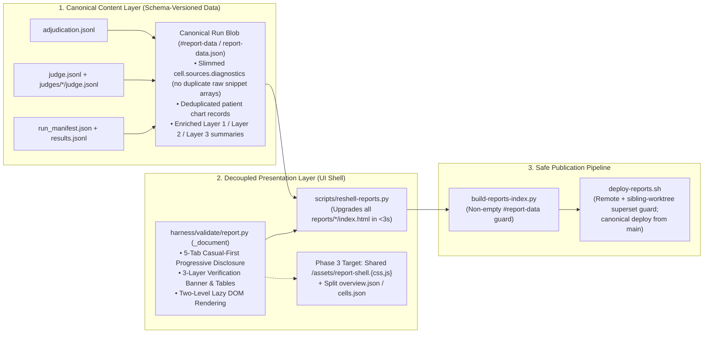

# Report Display vs. Content Separation, Payload Bloat, and Publication Architecture Remediation

**Date:** 2026-11-09  
**Scope:** `clinical-ai-validation-harness` (`harness/validate/report.py`) · `openclinai.org` (`reports/`, `scripts/reshell-reports.py`, `scripts/build-reports-index.py`, `scripts/deploy-reports.sh`)

---

## 1. Executive Summary & Root-Cause Audit

On 9 November 2026, an end-to-end audit of `https://reports.openclinai.org/` and all 33 staged report directories under `reports/` identified four structural failure modes caused by tightly coupling **report presentation (`_STYLE` + `_SCRIPT` + HTML shell)** to **report content (`#report-data` JSON)** inside monolithic static `reports/<slug>/index.html` files and deploying them from parallel git worktrees:

| Failure Mode | Observed Symptom on `reports.openclinai.org` | Root Cause |
| :--- | :--- | :--- |
| **F1. Frozen Legacy UI on Published Reports** | 31 of 32 published reports (including all WAHS and MacBook runs) rendered without the 5-Tab Casual-First UI or 3-Layer Verification Banner (`5-tab=False`, `vtiers=False`). | `build_report()` bakes `_STYLE` (CSS) and `_SCRIPT` (JS) directly into each `reports/<slug>/index.html` at creation time. Subsequent upgrades to `harness/validate/report.py` never propagate to already-published reports unless they are re-shelled. |
| **F2. 18.5 MB Payload Bloat on Multi-Arm WAHS Reports** | `2026-11-05-wahs-multi-family-3-pathway-eval/index.html` (`27 setups × 36 turns = 972 cells`) was **18,537.7 KB (18.5 MB)**; `2026-11-03` was **4.45 MB**; `2026-11-02` was **3.24 MB**. | Inside `run.scenarios` (**15.1 MB**), every cell stored **both** `cell.sources` (**6.5 MB** of raw structured JSON repeating full patient chart snippets across all 27 setups) **and** `cell.sources_html` (**6.0 MB** of pre-rendered HTML cards for the exact same citations), even though the client JS only reads `cell.sources.diagnostics` (3 integer ref counts) and `cell.sources_html`. |
| **F3. Multi-Second Main-Thread Freeze on Boot** | Opening `2026-11-05-wahs-multi-family-3-pathway-eval` blocked the browser main thread while constructing **50,000+ DOM nodes** before first paint. | `renderRun()` synchronously iterated over all 972 cells and injected 6.0 MB of `cell.sources_html` + `cell.refs_html` into live DOM nodes on page load—even when the user starts on **Tab 1 (`Overview`)** (`#sec-answers` hidden) and `.compact-tiles` hides `.sources` (`display: none`). |
| **F4. Parallel Worktree `rsync --delete` Collisions** | Running `scripts/deploy-reports.sh` from a feature worktree lacking sibling branches' `reports/<slug>/` directories wiped WAHS reports from `reports.openclinai.org`. | Multiple active git worktrees had direct SSH access to run `rsync -az --delete` against `34.59.0.158:openclinai.org/artifacts/reports/` without checking remote or sibling-worktree report manifests. |
| **F5. CSS Table Collision & Domain-Hardcoded Overview Copy** | On `2026-11-05-wahs-multi-family-3-pathway-eval/index.html`, the `Head-to-Head Comparison` table rows (`<tr class="exec-row">`) were squished into CSS grids inside the first column, the 9-model × 3-pathway study takeaway (`run.context.text`) was hidden, `Layer 1` showed `0/0 refs resolved`, and `3 · Response Speed` showed `— avg total wait`. | `.exec-row { display: grid }` overrode `<tr class="exec-row">` table rows; `renderExecutiveSummary()` hardcoded ChartSearchAI HIV copy (`"10 synthetic HIV patient charts"`, `"OpenMRS chart UUIDs"`) and assumed non-zero latency instead of adapting declaratively to the run's data capabilities (`judge[b].citation_resolution`, `run.context`, `safety_adjusted_benchmark_score`). |

---

## 2. Why We Had 4 Separate Report Formats (and How We Eliminate Per-Type Migration Forever)

### 2.1 Inventory of the 33 Staged Report Directories in `reports/`

| Format / Generator | Count | Example Slugs | Data Representation | Current Status |
| :--- | :---: | :--- | :--- | :--- |
| **1. Unified `validate` Schema (`harness/validate/report.py`)** | **28** | All 21 ChartSearchAI runs (`2026-07-*` to `2026-11-07-*`) + 7 WAHS / MacBook runs (`2026-11-02` to `2026-11-06`, including `2026-11-05-wahs-multi-family-3-pathway-eval` & `2026-11-04-wahs-macbook-direct-vs-hub-multi-scenario-eval`) | ``, loading `../assets/report-shell.{css,js}?v=58cbaf97e1`). Total HTML across all 35 published reports is **0.09 MB** (down from 49.56 MB).
  - `report-shell.js` supports both inline `#report-data` and external `./report-data.json`.
  - `scripts/reshell-reports.py` is a pure, harness-free static shell updater that reads `reports/assets/report-shell.{css,js}` and `reports/<slug>/report-data.json` without importing `harness`.
- [x] **Invariant 4 — Single-Pass `publish-report.sh` & `stage-report.py`:**
  - Running `publish-report.sh` stages a report and automatically links `../assets/report-shell.{css,js}?v=<hash>` and writes `report-data.json` when `reports/assets/report-shell.js` is present, while preserving 100% compatibility with `tests/website/test_publish_report_contract.py` and `test_stage_report.py`.
- [x] **Invariant 5 — Catalog Builder (`build-reports-index.py`) Reads Canonical `meta.json` & `report-data.json`:**
  - `build-reports-index.py` validates archives against `report-data.json` (or `#report-data`) and reads frozen `meta.json` / `report-data.json` first without requiring raw `results.jsonl` to be parsed when `meta.json` is populated.
- [x] **Invariant 6 — Single Canonical `main` Baseline & Complete Published Catalog (35 Reports Live):**
  - Canonical `main` in both `clinical-ai-validation-harness` and `openclinai.org` holds 100% of commits, the 2 stranded published reports from `checked-answers` (`l5-full-default-2026-10-28-2a053c09` and `l5-answer-rules-fresh-2026-10-29-effa8855`) are restored and reshelled onto `main` (35 active report directories total), `deploy-reports.sh` checks local branches as well as worktrees, and live `https://reports.openclinai.org/` matches `origin/main` byte-for-byte.

