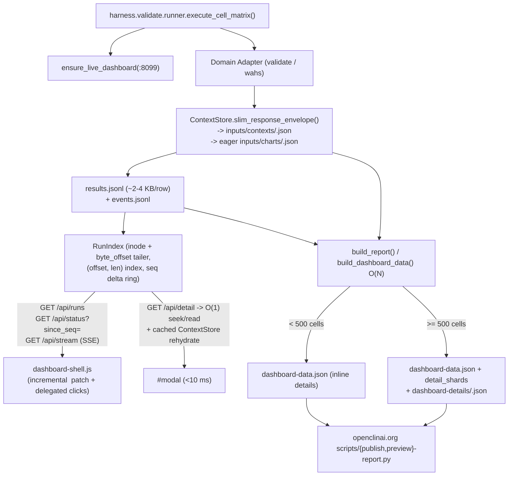

# Unified Evaluation Spine, Context-Normalized Runs & Indexed Dashboard Architecture

This specification defines the converged execution, storage, live-monitoring, and static-report packet architecture shared across `clinical-ai-validation-harness` and `openclinai.org` (`openclinai.dashboard.v2` / `openclinai.report.v2`).

## 1. Design Principles

1. **Single execution spine across evaluation families:** Every suite runner (`validate` / `chartsearchai`, `catalyst`, and `wahs`) executes cell matrices through `harness.validate.runner.execute_cell_matrix()`, sharing mandatory live-dashboard registration (`:8099`), upfront scenario input freezing, `--resume` skip/carry-over logic, per-cell fault isolation for live benchmarks, and canonical `events.jsonl` emission.
2. **Normalized context storage on write, transparent rehydration on read:** Patient chart condensation text (`condensed_text`), `[N]` UUID mappings (`mappings`), valid/retained UUID sets, and `x_wahs.citation_map` are identical across prompts/arms/seeds targeting the same condensed chart. They are content-addressed once into `inputs/contexts/<sha256_16>.json` and referenced via `response.context_ref`, keeping `results.jsonl` rows compact (~2–4 KB instead of ~830 KB) while `inputs/charts/<scenario_id>.json` is materialized eagerly during execution.
3. **Incremental byte-offset live indexing (`O(Δ)` status, `O(1)` detail):** The live monitor (`scripts/validate-dashboard.py`) reads new bytes from `(st_ino, byte_offset)` only up to complete `\n`-terminated records via `RunIndex`, maintaining per-cell `(offset, length)` byte pointers and mtime-cached sidecars. `/api/detail` performs an `O(1)` byte-slice `seek`/`read` regardless of total `results.jsonl` size.
4. **Push/delta transport + incremental DOM:** The browser viewer (`reports/assets/dashboard-shell.js`) connects over HTTP/1.1 to `GET /api/stream` (SSE) with single-flight `setTimeout` polling fallback (`/api/status?run=...&since_seq=...`), patches only changed `<td>` grid cells in place via delegated click handlers, opens `#modal` immediately with a loading state + `AbortController`, and switches between active/recent runs via `GET /api/runs`.
5. **Single-pass `O(N)` static compilation + backward-compatible sharding:** `build_report()` and `build_dashboard_data()` group `results.jsonl`, `trace.jsonl`, `judges/`, and `inputs/charts/` in one pass. Runs with `< 500` clickable cells continue to embed inline `details` inside `dashboard-data.json`; runs with `>= 500` clickable cells shard cell details per arm into `dashboard-details/<idx>-<arm>-<sha1_8>.json` (`detail_shards` map), loaded on demand by `dashboard-shell.js` and staged/served cleanly by `publish-report.py` and `preview-report.py` with zero `harness` imports.

---

## 2. Data & Control Flow



---

## 3. On-Disk Packet Contract Extensions (`openclinai.dashboard.v2`)

### 3.1 Normalized `results.jsonl` & `inputs/contexts/`
- `run_dir/inputs/contexts/<sha256_16>.json`:
  ```json
  {
    "schema": "openclinai.context.v1",
    "condensed_text": "...",
    "mappings": [...],
    "valid_uuids": [...],
    "retained_uuids": [...],
    "x_wahs_citation_map": ...
  }
  ```
- Slimmed `results.jsonl` rows store `response.context_ref = "<sha256_16>"` with duplicated `mappings`, `condensed_text`, `valid_uuids`, `retained_uuids`, and `x_wahs.citation_map` removed.
- Legacy `results.jsonl` rows containing inline payloads remain 100% readable by `ContextStore.rehydrate_response_envelope()`, `review_results()`, `score_wahs_run()`, and `RunIndex.get_detail()`.

### 3.2 Sharded Static Detail Packets (`detail_shards`)
- `dashboard-data.json` preserves `"schema": "openclinai.dashboard.v2"` and `"schema_version": 2`:
  - When clickable cells `< 500`: `"details": { "scenario|backend": { ... } }` (inline, unchanged).
  - When clickable cells `>= 500`: `"details": {}` and `"detail_shards": { "<backend_id>": "dashboard-details/00-arm-hash.json", ... }`.
- Each shard file under `dashboard-details/<file>.json` maps `"scenario|backend"` keys for that backend to the exact same deduplicated cell objects referencing top-level `record_pool`, `sources_pool`, and `refs_pool` in `dashboard-data.json`, and must contain zero forbidden HTML keys (`FORBIDDEN_HTML_KEYS`).

---

## 4. Complexity & Scalability Summary

| Operation | Before | After |
| :--- | :--- | :--- |
| `results.jsonl` row size (WAHS) | ~830 KB/row (`1.2 GB` @ 2,820 cells) | ~2–4 KB/row (`< 12 MB` @ 4,500 cells) |
| Live `newest_run()` discovery | Recursive `**/*.json` glob per request | `O(1)` stat on top-level marker files |
| Live `/api/status` & `/api/stream` | Full `results.jsonl` re-parse (`~8.4 s` @ 832 MB) | `O(Δ)` tail read + `since_seq` deltas (`< 5 ms`) |
| Live `/api/detail` click | Full `results.jsonl` re-parse (`~6.2 s` @ 832 MB) | `O(1)` `seek`/`read` + cached context (`< 10 ms`) |
| `build_dashboard_data()` | `O(N²)` re-read per cell (`N` full parses) | `O(N)` single pass (`~1–3 s` @ 4,500 cells) |
| Static browser load (`4,500` cells) | Single multi-MB `dashboard-data.json` + inline `onclick` rebuild | Compact summary/pools + lazy per-arm `dashboard-details/` shard fetch |
